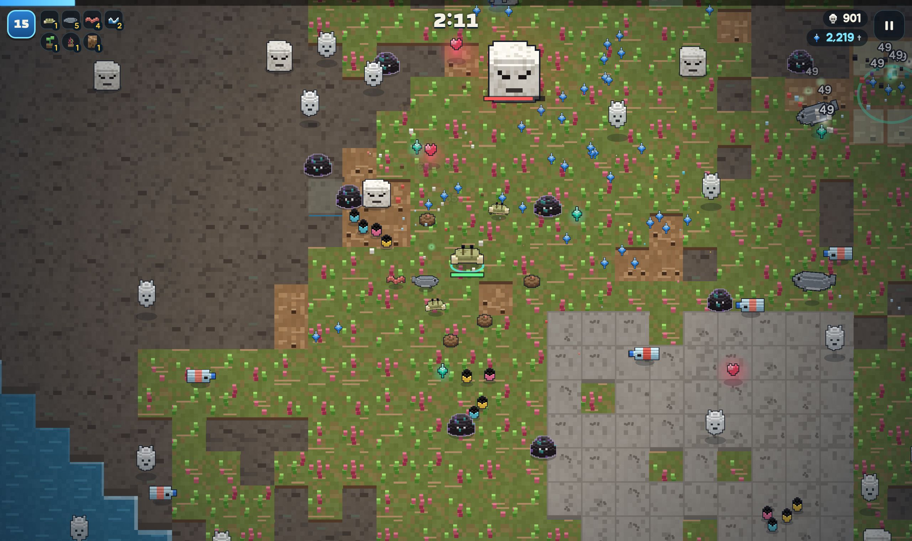
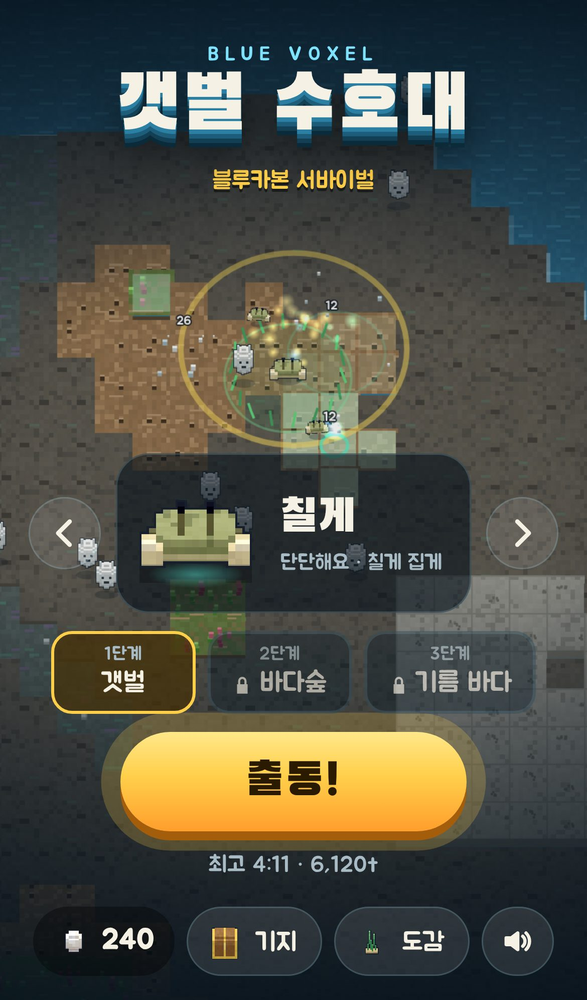
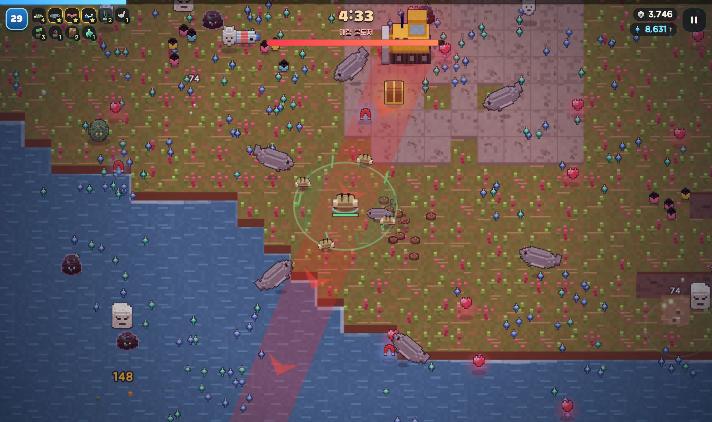
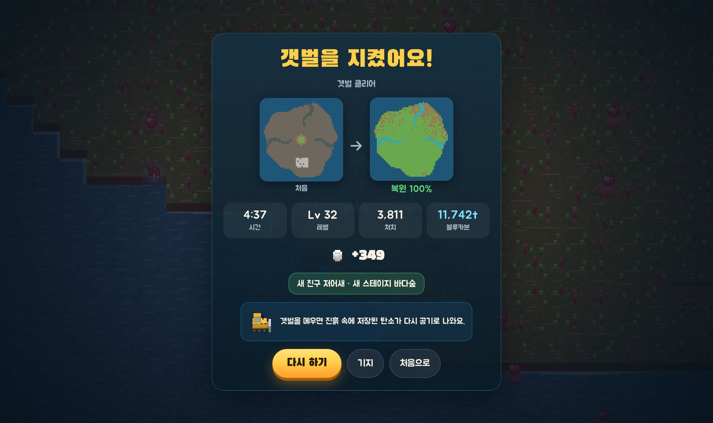

# 갯벌 수호대

손가락 하나로 움직이는 **갯벌 생존 액션 게임**이에요. 공격은 자동이고, 오염 몬스터를 쓰러뜨린 자리마다 갯벌이 되살아나요. (블루복셀 시리즈)

 

## 한눈에

| | |
|---|---|
| 장르 | 뱀서라이크(생존 액션), 한 판 5분, 화면 전체가 게임 |
| 조작 | 아무 데나 드래그(PC는 WASD·방향키), 공격은 자동, 레벨업 때 카드 3장 중 1장 |
| 재미 | 캐릭터 5종(칠게·점박이물범·저어새·짱뚱어·상괭이), 생물 무기 11종과 진화 11종, 패시브 11종, 스테이지 5개와 보스 5종, 별 난이도 5단계, 무한 모드, 업적 20개, 기지 강화 9종, 도감 46칸 |
| 배움 | 회색 오염 땅에서 몬스터가 솟아나고, 쓰러뜨린 자리는 초록 갯벌로 살아나요. 초록 땅에선 회복·공격 속도 ↑, 복원율 단계마다 보상, 돌아오는 생물. 파란 결정 = 탄소(점수 = 블루카본 t), 매립 불도저가 지나가면 CO₂ |
| 줍는 재미 | 쓰레기 더미 부수기, 큰 물결·소라 나팔·진주 주머니·저어새 깃털, 콤보, 오늘의 도전, 꾸미기(모자·선글라스·왕관) |
| 환경 | 설치·로그인·광고·확률형 아이템 없음, 파일 하나(약 220KB), 휴대폰·태블릿·PC |

 

## 실행

- `game/index.html`을 브라우저로 열어요.
- `npm run build` → `dist/gaetbeol.html` 한 파일로 나눠 줄 수 있어요.
- 토론 수업용 전략 버전(블루복셀: 갯벌마을 2050)은 `prototype/`에 있어요 (`npm run build:prototype`).

## 문서

| 문서 | 내용 |
|---|---|
| [05 캐주얼 전환](docs/05-casual-pivot.md) | 왜 바꿨는지, 장르 조사, 재미 구조, 글 없이 넣은 생태 메시지, 수치 |
| [04 상용화 계획](docs/04-commercial-plan.md) | 고객, 차별점, 출시 체크리스트 |
| [06 AI 인수인계](docs/06-ai-handoff.md) | 다른 AI에게 넘길 요청 이력·설계·코드 구조·수치·한계·분석 프롬프트 |
| [01 상위 게임 분석](docs/01-trend-analysis.md) · [02 기획서](docs/02-game-design.md) · [03 수업 가이드](docs/03-classroom-guide.md) | 전략 버전 문서 |

## 개발

```bash
npm test          # 게임 로직 테스트 (갯벌 수호대 + 전략 버전)
npm run balance   # 자동 조종으로 스테이지·캐릭터별 승률
npm run build     # 한 파일 빌드
```
