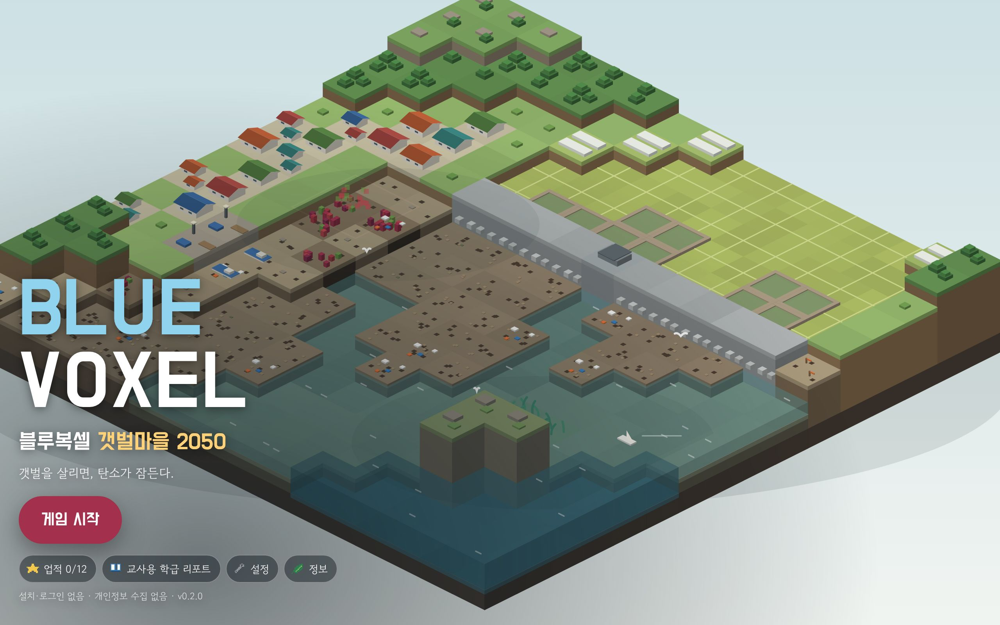
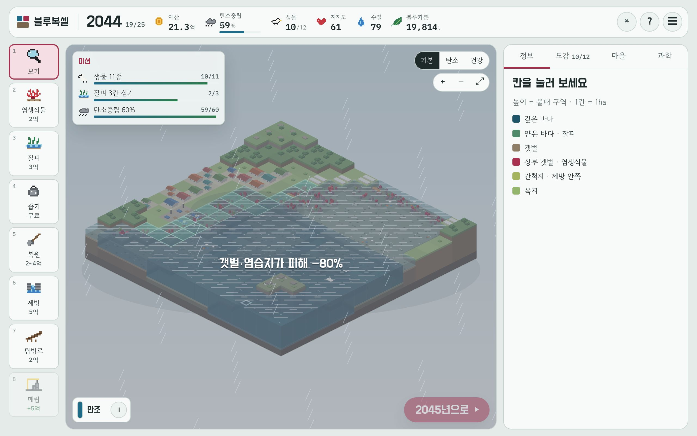
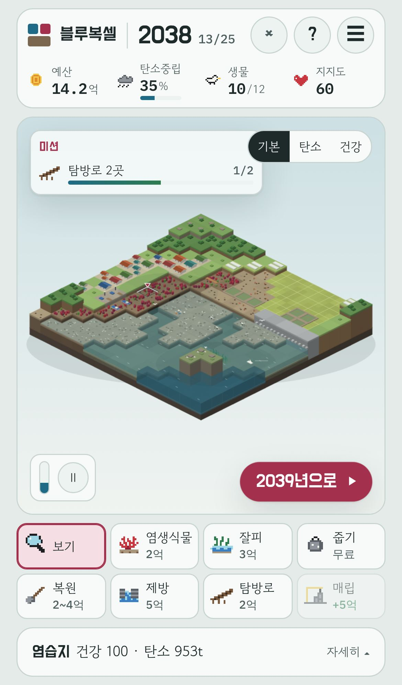

# 블루복셀: 갯벌마을 2050

갯벌을 되살려 2050년 탄소중립에 도전하는 **블루카본 교육용 복셀 전략 게임**이에요.



## 핵심

| | |
|---|---|
| 장르 | 턴제 갯벌 복원 전략 · 생물 도감 · 마을 회의 |
| 배움 | 진흙 속 탄소 저장, 매립하면 배출, 생태계 연결, **감축 + 흡수 = 탄소중립** |
| 재미 | CO₂가 진흙으로 스며드는 연말 연출, 태풍 해일, 생물 등장, 미션 14 · 업적 12 · 난이도 3, 효과음·음악 |
| 수업 | 수업 코드(같은 사건), 결과 코드 → 교사용 학급 리포트, 엔딩별 토론 질문 |
| 환경 | 설치·로그인·개인정보 수집 없음, 오프라인 한 파일, PC·크롬북·태블릿·휴대폰 |

 

## 실행

- `prototype/index.html`을 브라우저로 열어요.
- `npm run build` → `dist/bluevoxel.html` 한 파일로 나눠 줄 수 있어요.

## 문서

| 문서 | 내용 |
|---|---|
| [01 상위 게임 분석](docs/01-trend-analysis.md) | 2025~2026 흥행작 분석 → 장르 결정 |
| [02 게임 기획서](docs/02-game-design.md) | 교육 목표, 규칙과 수치, 밸런스 |
| [03 수업 가이드](docs/03-classroom-guide.md) | 2차시 수업안, 토론 질문, 활동지 |
| [04 상용화 계획](docs/04-commercial-plan.md) | 고객, 차별점, 출시 체크리스트 |

## 개발

```bash
npm test          # 게임 로직 테스트
npm run balance   # 전략별 자동 플레이 결과
npm run build     # 한 파일 빌드
```
