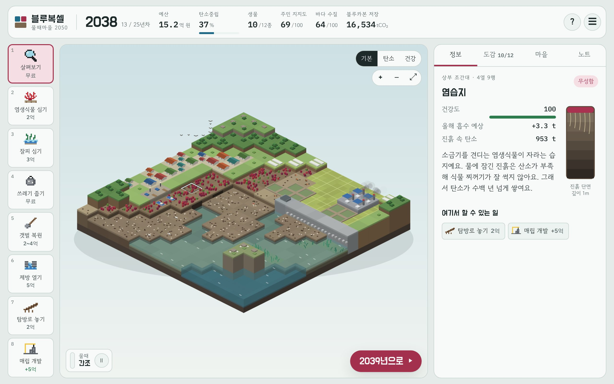
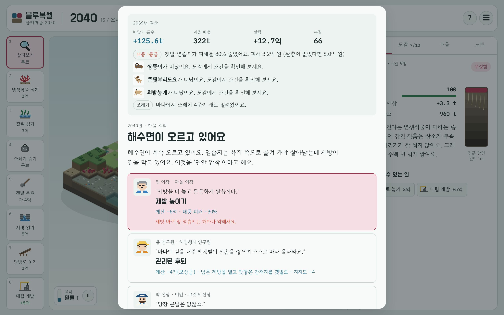

# 블루복셀: 갯벌마을 2050

서해 어촌의 갯벌을 되살리며 **블루카본**과 **생태전환**을 배우는 복셀 전략 게임 프로토타입이에요. 학생은 ‘물때마을’의 청소년 생태전환위원이 되어 2026년부터 2050년까지 25년 동안 마을의 바닷가를 설계해요.



## 바로 해 보기

- **설치 없이**: `prototype/index.html`을 브라우저로 열면 돼요. 인터넷이 없어도 실행돼요(글꼴만 시스템 글꼴로 바뀌어요).
- **파일 하나로 나눠 주기**: `npm run build` → `dist/bluevoxel.html` 한 파일을 메일·USB·학습 플랫폼으로 배포해요.
- **웹에 올리기**: 정적 파일이라 어떤 웹 호스팅에도 그대로 올릴 수 있어요.

## 어떤 게임인가요?

| | |
|---|---|
| 장르 | 턴제 생태복원 전략 + 서식지 도감 수집 + 마을 회의(선택형 서사) |
| 대상·시간 | 중학생 중심(초5~고1), 한 판 15~25분, 수업 1~2차시 |
| 한 해의 흐름 | 마을 소식·회의 선택 → 도구로 바닷가 바꾸기 → 연말 결산(탄소·생물·살림) |
| 핵심 규칙 | 복셀 높이 = 물때 구역. 염생식물은 상부 갯벌에, 잘피는 얕은 바다에. 생태계는 진흙 속에 해마다 탄소를 쌓고, 메우면 쌓인 탄소가 빠져나가요. |
| 목표 | ① 흡수: 갯벌·염습지·잘피밭 지키고 넓히기 ② 감축: 마을 배출 줄이기 ③ 공존: 생물 12종과 주민 지지 |
| 엔딩 | 블루카본 마을 / 되살아난 갯벌, 남은 숙제 / 회색 해안 / 지켜보기만 한 바다 / 함께하지 못한 전환 / 절반의 전환 |
| 수업 기능 | 수업 코드(같은 코드 = 같은 사건 순서), 결과 복사, 자동 저장, 엔딩별 성찰 질문 |

 

## 왜 이런 게임인가요?

2025~2026년 흥행작(Pokémon Pokopia, Grow a Garden, Subnautica 2, Dave the Diver, Slay the Spire 2 등)을 분석해 보니, **서식지를 가꾸면 생물이 돌아오는 코지 루프**, **바다 소재**, **짧은 판과 시너지 발견**이 공통점이었어요. 블루카본의 이야기(되살리면 시간이 지나 탄소가 쌓이고 생물이 돌아온다)가 이 구조와 그대로 겹쳐서, 퀴즈를 덧붙이지 않고 **규칙 자체가 개념을 가르치는** 턴제 복원 전략 게임으로 정했어요. 자세한 근거는 문서에 있어요.

## 문서

- [01. 최근 상위 게임 분석과 장르 결정](docs/01-trend-analysis.md)
- [02. 게임 기획서](docs/02-game-design.md): 교육 목표, 개념↔규칙 매핑, 시스템 수치, 밸런스 검증, 과학적 근거와 단순화, 로드맵
- [03. 수업 활용 가이드](docs/03-classroom-guide.md): 2차시 수업안, 디브리핑 질문, 오개념 바로잡기, 활동지, 평가 루브릭

## 폴더 구조

```text
prototype/
  index.html        게임 화면
  css/style.css     디자인 토큰(밝은·어두운 테마), 반응형 레이아웃
  js/data.js        지도, 타일, 도구, 생물 도감, 회의 카드, 엔딩, 과학 노트, 픽셀 스프라이트
  js/sim.js         시뮬레이션(탄소·수질·생물·경제·태풍), DOM 없이 Node에서도 실행
  js/render.js      아이소메트릭 복셀 렌더러(Canvas 2D, 밀물·썰물, 생물 움직임, 효과)
  js/ui.js          HUD, 도구, 현장 노트, 회의·결산·엔딩 화면
  js/main.js        입력(터치·마우스·키보드), 한 해 흐름, 튜토리얼, 저장
tests/              게임 로직 테스트와 자동 플레이 도구
tools/              밸런스 점검, 단일 HTML 빌드
docs/               분석·기획·수업 문서와 화면 이미지
```

## 개발

Node 18 이상이 필요해요. 외부 패키지는 쓰지 않아요.

```bash
npm test            # 게임 로직 테스트 10개
npm run balance     # 전략 7가지로 2050년까지 자동 플레이한 결과 표
npm run build       # dist/bluevoxel.html 한 파일로 묶기
```

수치(흡수 속도, 비용, 생물 조건, 회의 카드)는 `prototype/js/data.js`와 `prototype/js/sim.js`에 모여 있어요. 숫자를 바꾼 뒤 `npm run balance`로 엔딩 분포가 의도대로인지 확인하세요. 현재 기준은 “복원만 하면 약 78%, 에너지 전환만 하면 약 33%, 둘 다 하면 100% 이상”이에요.

## 현재 상태와 다음 단계

v0.1 플레이 가능한 프로토타입이에요. 다음 단계로 학생 플레이테스트와 밸런스 조정, 사운드, 교사용 결과 모아 보기, 두 번째 지도(바다숲·갯녹음)를 계획하고 있어요. 자세한 로드맵은 [기획서 14절](docs/02-game-design.md#14-로드맵)에 있어요.

게임 속 사건은 실제 연구와 정책을 바탕으로 만든 가상 시나리오이고, 마을 배출량·예산·생물 조건 같은 숫자는 배우기 쉽게 단순화한 값이에요.
