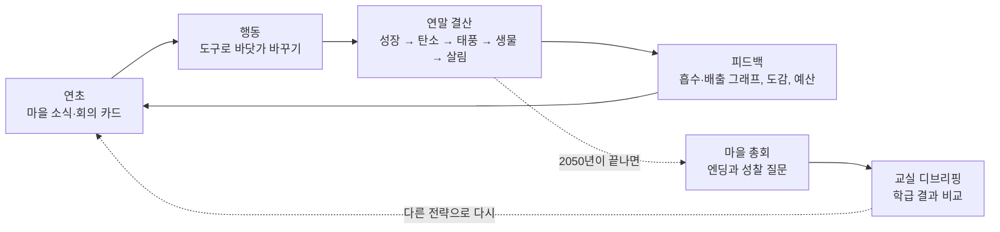
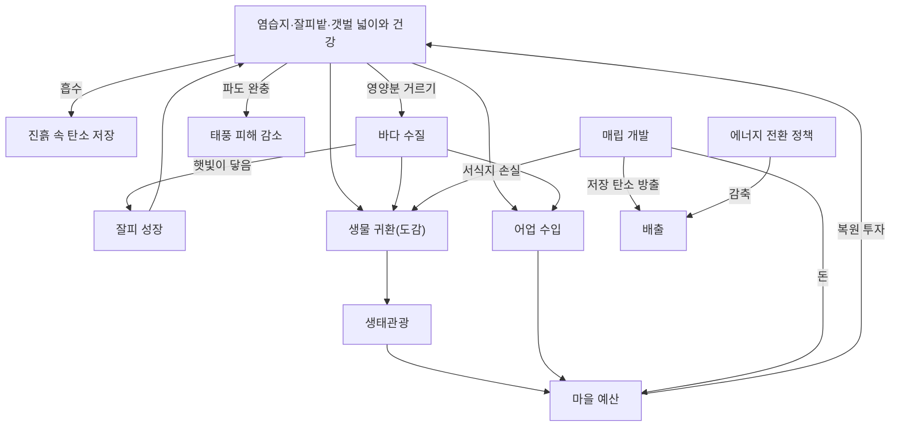

# 02. 게임 기획서 — 블루복셀: 갯벌마을 2050

> 버전 0.1 (플레이 가능한 프로토타입) · 이 문서의 수치는 `prototype/js/data.js`, `prototype/js/sim.js`와 같습니다.

## 0. 한눈에 보기

| 항목 | 내용 |
|---|---|
| 제목 | 블루복셀: 갯벌마을 2050 (BLUE VOXEL) |
| 한 줄 소개 | 서해 어촌 ‘물때마을’의 청소년 생태전환위원이 되어, 2026년부터 2050년까지 갯벌을 되살리고 마을의 탄소중립을 설계하는 턴제 전략 게임 |
| 장르 | 턴제 생태복원 전략 시뮬레이션 + 서식지 도감 수집 + 마을 회의(선택형 서사) |
| 그래픽 | 아이소메트릭 복셀 디오라마, 밀물·썰물 실시간 표현, 밤(다크) 테마 |
| 대상 | 중학생 중심 (초5~고1 조정 가능) |
| 플랫폼 | 웹 브라우저 (PC·크롬북·웨일북·태블릿·휴대폰), 설치·로그인 없음, 파일로 오프라인 실행 |
| 플레이 시간 | 1판 15~25분 (25턴), 수업 1~2차시 |
| 인원 | 1인 또는 2~3인 모둠, 같은 ‘수업 코드’로 학급 전체가 같은 조건에서 플레이 |
| 핵심 질문 | “갯벌을 지키고 되살리면 우리 마을은 탄소중립을 이룰 수 있을까? 무엇이 더 필요할까?” |

## 1. 교육 목표

1. **(개념)** 블루카본의 뜻과 대표 생태계(염습지·잘피밭·갯벌)를 설명할 수 있다.
2. **(원리)** 물에 잠긴 진흙에서 탄소가 오래 저장되는 이유와, 매립·간척이 저장된 탄소를 배출로 바꾸는 과정을 설명할 수 있다.
3. **(시스템 사고)** 갯벌 복원이 탄소뿐 아니라 수질, 생물다양성, 재해 완충, 어업과 관광으로 이어지는 연결고리를 찾을 수 있다.
4. **(가치 판단)** 개발과 보전, 서로 다른 기후 해법 사이의 상충을 이해하고, 여러 이해관계자의 관점에서 근거를 들어 결정할 수 있다.
5. **(행동)** 블루카본만으로는 탄소중립이 어렵다는 점을 알고, 배출 감축과 생태계 보전을 함께 담은 우리 지역의 실천 방안을 제안할 수 있다.

**생태전환교육과의 연결.** 2022 개정 교육과정 총론은 생태전환교육과 민주시민교육을 모든 교과에 걸친 교육 방향으로 강조합니다. 이 게임은 생태전환교육의 네 축을 규칙으로 옮겼어요.

| 생태전환교육의 축 | 게임 속 구현 |
|---|---|
| 인간과 자연의 상호의존 | 갯벌의 건강이 마을의 어업 수입·태풍 피해·관광으로 바로 이어져요. |
| 기후위기의 구조적 원인 이해 | 간척·매립, 화석연료 배출, 오염이 각각 수치로 쌓여요. |
| 삶과 사회의 전환 | 에너지 전환(어선·지붕 태양광·버스·리모델링)과 해수유통·관리된 후퇴 같은 제도 선택이 있어요. |
| 행위주체성과 참여 | 플레이어는 청소년 위원이에요. 주민 지지도를 잃으면 좋은 정책도 오래가지 못해요. |

## 2. 핵심 개념을 게임 규칙으로

학습 내용을 퀴즈로 덧붙이지 않고, 규칙 자체가 개념을 말하도록 설계했어요(내재적 통합, Habgood & Ainsworth 2011).

| 전달할 개념 | 게임 규칙 | 플레이어가 겪는 순간 |
|---|---|---|
| 블루카본은 진흙 속에 저장된다 | 생태계 칸마다 ‘진흙 속 탄소’가 있고, 해마다 흡수한 만큼 쌓여요. | 정보 탭의 진흙 단면이 해마다 짙어져요. ‘탄소’ 보기로 저장고가 어디 있는지 봐요. |
| 흡수는 느리고 배출은 빠르다 | 매립하면 저장량의 절반이 배출 대기열에 들어가 해마다 30%씩 빠져나가요. | 2028년 산업단지를 승인하면 배출 그래프가 크게 솟아요. |
| 높이(물때)마다 사는 생물이 다르다 | 복셀 층 = 물때 구역. 염생식물은 상부 갯벌에만, 잘피는 얕은 바다에만 심을 수 있어요. | 낮은 갯벌에 심으려 하면 “밀물마다 잠기는 곳”이라는 안내가 나와요. |
| 회복에는 시간이 걸린다 | 새싹 → 자라는 중 → 무성함, 흡수량은 35% → 70% → 100%. | 심은 해에는 흡수가 작고, 몇 해 뒤 커져요. |
| 공간을 내주면 자연이 스스로 회복한다 | 다 자란 염습지·잘피밭은 이웃 칸으로 저절로 퍼져요. | 결산에 ‘자연 회복 n칸’이 떠요. |
| 간척과 제방이 물길을 끊었다 | 제방 뒤 간척지는 제방을 열어야 복원돼요. 복원은 바다와 맞닿은 칸부터 안쪽으로 번져요. | 제방을 열면 그 칸에 처음으로 밀물이 들어와요. |
| 생태계는 연결돼 있다 | 염습지가 수질을 높이고, 수질이 잘피를 키우고, 잘피밭이 해마·상괭이를 불러요. | 도감 조건을 채우려다 보면 연결고리를 발견해요. |
| 공편익 | 어업 = 갯벌·잘피 건강 × 수질, 태풍 피해 = 마을 앞 완충, 관광 = 함께 사는 생물 수. | “갯벌·염습지가 태풍 피해를 46% 줄였어요.” |
| 블루카본만으로는 부족하다 | 마을 배출 480 t/년(가상)에 비해 바닷가 흡수는 최대 약 300 t/년. | 아무리 복원해도 에너지 전환 없이는 탄소 저울이 기울지 않아요. |
| 이해관계자의 관점 | 6명의 주민이 서로 다른 선택지를 말해요. 정답이 정해져 있지 않아요. | 마을 회의 카드 |
| 친환경 해법도 장소가 중요하다 | 폐양식장에 태양광을 지으면 배출은 줄지만 갯벌로 되돌릴 기회가 사라져요. | 2027년 회의, 2036년 지붕 태양광 회의 |
| 탄소 크레딧과 이중 계산 | 크레딧을 팔면 그 흡수량은 기업 몫이 되어 마을 계산에서 빠져요. | 2035년 회의 |
| 회색 인프라와 자연기반해법 | 제방 높이기는 태풍 피해를 줄이지만 제방 앞 염습지가 약해져요(연안 압착). | 2040년 회의 |
| 아무것도 하지 않는 것도 선택 | 쓰레기와 오염이 쌓이고 생물이 떠나요. | ‘지켜보기만 한 바다’ 엔딩 |

## 3. 게임 흐름

### 3.1 코어 루프

### 3.2 시스템 연결도

### 3.3 한 해의 순서

1. **연초**: 일정표의 회의·소식 카드가 나와요. 선택지를 고르면 바로 효과가 적용돼요(태풍·열파는 연말에 일어나요).
2. **행동**: 예산 안에서 도구를 원하는 만큼 써요. 첫해에는 튜토리얼 도움말이 단계별로 안내해요.
3. **연말 결산**(‘다음 해로’): 해양 열파 → 수질 갱신 → 생태계 건강·성장·확산 → 탄소 흡수·배출 → 태풍 → 쓰레기 유입 → 생물 판정 → 수입 → 주민 지지도 → 기록.
4. 결산 화면과 다음 해 카드가 한 화면에 함께 나와요(클릭 수를 줄이기 위해).

## 4. 세계와 지도

**물때마을**은 서해의 작은 어촌이에요(가상). 1990년대에 앞바다 일부를 막아 간척 농지와 새우 양식장을 만들었고, 지금은 양식장이 버려져 있어요. 갯벌 앞에는 저어새가 둥지를 트는 무인도가 있어요.

- 지도는 16 × 16칸, **한 칸 = 1ha**. 처음에는 갯벌 45, 상부 갯벌 12, 염습지 3, 잘피밭 3칸(블루카본 생태계 63ha), 간척 농지 33, 폐양식장 10, 제방 11칸이 있어요.
- **복셀 높이 = 물때 구역**

| 높이 | 구역 | 타일 |
|---|---|---|
| 0 | 조하대(깊은 곳) | 깊은 바다 |
| 1 | 조하대(얕은 곳) | 얕은 바다, 잘피밭, 갯골 |
| 2 | 조간대 | 갯벌 |
| 3 | 상부 조간대 / 간척지 | 상부 갯벌, 염습지 / 간척 농지, 폐양식장, 태양광 |
| 4 | 육지·구조물 | 마을, 포구, 밭, 들판, 제방, 산업단지, 리조트 |
| 5~6 | 높은 땅 | 솔숲, 무인도, 뒷산 |

- **밀물·썰물**: 화면 속 물높이는 26초 주기로 1.4층(간조)과 3.3층(만조) 사이를 오르내려요. 간조에는 갯벌이 드러나 게와 짱뚱어가 보이고, 만조에는 상부 갯벌까지 잠겨요. 제방 안쪽 간척지에는 물이 들어오지 않아요. 해수면 상승은 해마다 조금씩 화면에 반영돼요(표현을 위해 과장).

## 5. 도구

| 도구 | 비용 | 쓸 수 있는 곳 | 효과 | 배우는 것 |
|---|---|---|---|---|
| 살펴보기 | 무료 | 모든 칸 | 상태, 저장 탄소, 올해 흡수, 진흙 단면, 할 수 있는 일 | 탄소가 어디에 쌓이는지 |
| 염생식물 심기 | 2억 | 상부 갯벌(쓰레기 없는 칸) | 염습지 새싹 | 염습지는 큰 밀물 때만 잠기는 높이에서 자람 |
| 잘피 심기 | 3억 (연구 협력 시 2억) | 얕은 바다 | 잘피밭 새싹. 수질 50 미만이면 잘 자라지 못함 | 잘피는 꽃 피는 식물, 맑은 물이 필요 |
| 쓰레기 줍기 | 1억 (갯벌 학교 운영 시 무료) | 쓰레기 칸 | 쓰레기 제거 | 해양쓰레기가 서식지를 망가뜨림 |
| 갯벌 복원 | 4억 (폐양식장 복원 계획 시 2억) | 바닷물과 맞닿은 폐양식장·간척 농지 | 복원 중인 상부 갯벌(3년간 회복) | 물길을 트는 순서, 역간척 |
| 제방 열기 | 5억, 지지도 −1 | 바다와 맞닿은 제방 | 복원 중인 상부 갯벌 | 해수유통 |
| 탐방로 놓기 | 2억 | 육지·탐방로와 이어진 갯벌·염습지 | 생태관광 수입 | 지속 가능한 관광 |
| 매립 개발 | 수입 +5억, 지지도 +2 | 육지와 맞닿은 갯벌·염습지 | 산업단지(세금 0.4억/년), 저장 탄소 절반 배출 시작 | 단기 이익과 장기 손실 |

해양보호구역이 지정되면 매립 개발이 막혀요. 지지도가 30 미만이면 모든 비용이 1억씩 올라요.

## 6. 시스템과 수치

### 6.1 탄소

- **흡수(tCO₂/ha/년)** = 기본 속도 × 성장 단계 배수 × 건강도/100
  - 기본 속도: 염습지 **3.3**, 잘피밭 **1.6**, 갯벌·상부 갯벌 **1.0** (복원 중이면 ×0.6)
  - 성장 단계 배수: 새싹 0.35, 자라는 중 0.7, 무성함 1.0
- **저장량(시작값, tCO₂)**: 갯벌 170~210, 상부 갯벌 160~200, 염습지 820~1,000, 잘피밭 360~420, 간척 농지 55~75, 폐양식장 70~90. 흡수한 만큼 해마다 더해져요.
- **매립·개발**: 저장량의 50%가 배출 대기열로, 50%는 메운 땅 아래 남아요. 대기열은 해마다 30%씩 배출돼요. 잘피밭이 죽으면 저장량의 30%가 같은 방식으로 빠져나가요.
- **마을 배출**: 2026년 480 tCO₂(학습용 가상값), 국가 전력 전환으로 해마다 1% 감소, 정책별 감축(곱으로 적용): 폐양식장 태양광 12%, 전기 어선 10%, 지붕 태양광 15%, 마을버스·농기계 전기화 8%, 에너지 리모델링 12%.
- **탄소중립률** = 마을 몫 흡수량 ÷ (마을 배출 + 매립지 배출). 탄소 크레딧을 팔면 마을 몫 흡수량은 절반이에요.

### 6.2 생태계 건강·성장·확산

- 건강도 상한 = 100 − 쓰레기 35 − 개발지와 맞닿음 15 − (잘피밭: 수질 62 미만이면 부족한 만큼 ×2.2) − (그 밖: 수질 35 미만이면 10) − (제방 높이기 선택 시 제방과 맞닿은 염습지 30).
- 건강도는 해마다 상한 쪽으로 최대 +8(복원 중 +10) 오르거나 최대 −20 내려가요.
- 성장: 염습지는 건강 50 이상이면 해마다 60% 확률로, 잘피밭은 건강 55 이상이고 수질 50 이상이면 50% 확률로 한 단계 자라요.
- 확산: 무성한 염습지(건강 60 이상)는 이웃 상부 갯벌로 해마다 18%, 무성한 잘피밭(수질 60 이상)은 이웃 얕은 바다로 12% 확률로 퍼져요.
- 소멸: 건강 15 미만이면 염습지는 맨 갯벌로, 잘피밭은 얕은 바다로 돌아가요.

### 6.3 바다 수질

목표 수질 = 66 − 0.35×간척 농지 − 0.25×밭 − 0.9×폐양식장 − 1.4×운영 양식장 − 2×산업단지 − 0.35×쓰레기 칸 + (하수처리 개선 +8, 아니면 −4) + min(18, 0.8×염습지 성숙도 합) + min(8, 0.4×잘피 성숙도 합). 친환경 농업을 지원하면 농경지 항목이 절반이에요. 실제 수질은 해마다 목표와의 차이의 절반만큼 움직여요(변화에 시간이 걸림). 시작 수질은 44예요.

### 6.4 생물 도감 (12종)

‘건강한 갯벌’은 건강 50 이상인 갯벌·상부 갯벌 넓이예요. 조건을 모두 채우면 연말에 나타나고, 깨지면 떠나요.

| 생물 | 사는 곳 | 나타나는 조건 | 담은 사실 |
|---|---|---|---|
| 갯지렁이 | 갯벌 | 건강한 갯벌 30ha | 굴을 파 갯벌에 산소를 넣음, 도요새의 먹이 |
| 칠게 | 갯벌 | 건강한 갯벌 40ha, 쓰레기 12칸 이하 | 진흙 속 유기물을 먹는 청소부 |
| 칠면초 | 염습지 | 염습지 2ha | 계절에 따라 초록에서 붉은 자줏빛으로 |
| 거머리말 | 얕은 바다 | 잘피밭 2ha | 해조류가 아닌 꽃 피는 식물 |
| 바지락 | 갯벌 | 건강한 갯벌 40ha, 수질 52 | 물을 걸러 먹는 맨손어업의 보물 |
| 농게 | 염습지 가장자리 | 염습지 6ha, 건강한 갯벌 40ha | 수컷의 큰 붉은 집게 |
| 짱뚱어 | 부드러운 진흙 | 건강한 갯벌 42ha, 수질 58, 쓰레기 5칸 이하 | 물 밖에서도 숨 쉬는 물고기 |
| 큰뒷부리도요 | 넓은 갯벌 | 건강한 갯벌 44ha, 쓰레기 4칸 이하 | 호주·뉴질랜드↔알래스카 이동 중 서해에서 쉬어 감 |
| 해마 | 무성한 잘피밭 | 무성한 잘피밭 4ha, 수질 62 | 잘피 잎을 꼬리로 감고 삶 |
| 흰발농게 | 모래 섞인 갯벌 | 건강한 갯벌 42ha, 염습지 10ha, 쓰레기 2칸 이하, 개발지 4칸 이하 | 멸종위기 야생생물 Ⅱ급 |
| 상괭이 | 서해·남해 연안 | 잘피밭 10ha, 수질 70, 쓰레기 3칸 이하 | 등지느러미 없는 토종 돌고래, 해양보호생물 |
| 저어새 | 넓은 갯벌 + 조용한 무인도 | 건강한 갯벌 42ha, 염습지 8ha, 보호 정책, 리조트 없음 | 멸종위기 Ⅰ급, 2025년 약 7천 마리로 회복 중 |

처음에는 갯지렁이·칠게·칠면초·거머리말 4종이 살아요. 상부 갯벌에 염생식물을 모두 심으면 ‘건강한 갯벌’ 넓이가 줄어 도요새 조건을 깨뜨릴 수 있어요. **열린 갯벌과 염습지가 섞인 모자이크**가 필요하다는 점을 배우게 돼요.

### 6.5 마을 살림 (억 원/년)

- 기본 예산 3
- 어업 = (0.06 × 갯벌 건강 합 + 0.10 × 잘피 성숙도 합 + 0.03 × 염습지 넓이) × (0.6 + 0.8 × 수질/100). 보호구역 ×0.85, 주민 공동관리 ×1.1, 풍년 ×1.3
- 농업 = 0.08 × 간척 농지 + 0.1 × 밭 (친환경 농업 ×0.9), 양식장 0.15/곳
- 생태관광 = 0.1 × 생물 종 수 + 탐방로마다 (0.15 + 0.03 × 생물 종 수), 보호구역 +1, 생태탐방센터 +0.5 + 0.05 × 생물 종 수
- 개발지 세금: 산업단지 0.4/칸, 리조트 1.0/칸 · 에너지: 태양광 0.1/칸, 지붕 태양광 +0.5
- 생태계서비스 지불제 0.03 × 건강한 생태계 넓이
- 지출: 제방 관리비 0.05/칸, 태풍 피해

시작 예산은 10억, 첫해 수입은 약 8억이에요.

### 6.6 주민 지지도 (0~100, 시작 55)

회의 선택(−4~+8), 매립(+2), 제방 열기(−1), 새로 만나거나 돌아온 생물(+1), 떠난 생물(−1), 쓰레기 12칸 초과(−1), 태풍 피해(−피해액), 예산 적자(−3). 70을 넘으면 해마다 −1, 40 미만이면 +1로 조금씩 되돌아가요.

### 6.7 태풍과 해수면

- 태풍 기본 피해 = 3 + 3 × 등급(억 원). 마을·포구 둘레 2칸의 완충값 P = 염습지(1.2 × 성장 단계/3 × 건강) + 갯벌(0.3 × 건강) + 잘피밭(0.2 × 성장 단계/3). 피해 감소율 = min(80%, P/12). 제방 높이기를 선택하면 +30%p(최대 90%). 해안 개발지는 칸마다 피해 +0.5.
- 결산 화면은 “완충이 없었다면 얼마였는지”를 함께 보여 줘요.
- 2040년 해수면 회의에서 ‘제방 높이기’는 태풍에 강해지지만 제방 앞 염습지가 연안 압착으로 약해지고, ‘관리된 후퇴’는 남은 제방을 모두 열고 맞닿은 간척지 두 겹을 갯벌로 돌려요.

## 7. 마을 회의·소식 카드

| 연도 | 카드 | 선택지 (요약) |
|---|---|---|
| 2026 | 생태전환위원회 첫 회의 | 해안 정화의 날 / 연구팀과 협력(잘피 비용↓) / 주민 설명회(지지도↑) |
| 2027 | 폐양식장, 어떻게 할까? | 태양광(배출 −12%) / 갯벌 복원 계획(복원비↓) / 양식장 재가동(수입↑, 수질↓) |
| 2028 | 산업단지 유치 제안 | 갯벌 6ha 매립 / 반대 / 대안: 간척 농지에 짓기 |
| 2029 | 태풍 예보 (2등급) | 연말에 태풍 |
| 2030 | 하얗게 덮인 갯벌 | 친환경 부표 / 주민 정화의 날 / 보류 |
| 2031 | 전기·하이브리드 어선 | 지원(배출 −10%) / 나중에 |
| 2032 | 갯벌을 어떻게 지킬까? | 해양보호구역 / 주민 공동관리 / 지정 안 함 |
| 2033 | 초록빛으로 변한 바다 | 친환경 농업 / 하수처리 개선 / 지켜보기 |
| 2034 | 무인도 앞 리조트 | 승인(저어새 번식 방해) / 생태탐방센터 / 거절 |
| 2035 | 갯벌 탄소, 나라가 인정하다 *(가상)* | 생태계서비스 지불제 / 탄소 크레딧 판매 / 그대로 |
| 2036 | 지붕 태양광 협동조합 | 시작(배출 −15%) / 보류 |
| 2037 | 해양 열파 | 연말에 잘피밭 피해 |
| 2038 | 우리 학교 갯벌 수업 | 운영(쓰레기 줍기 무료) / 보류 |
| 2040 | 해수면이 오르고 있어요 | 제방 높이기 / 관리된 후퇴 / 지켜보기 |
| 2042 | 마을버스·농기계 전기화 | 추진(−8%) / 나중에 |
| 2044 | 초강력 태풍 예보 (3등급) | 연말에 태풍 |
| 2046 | 신항만 건설 제안 | 찬성(잘피밭 매립) / 반대 · 보호구역이면 자동 철회 |
| 2048 | 에너지 리모델링 | 지원(−12%) / 보류 |
| 2050 | 마지막 한 해 | 엔딩 준비 |

2039·2041·2043·2045·2047·2049년에는 무작위 소식 6가지(철새 도래, 떠밀려 온 쓰레기, 바지락 풍년, 갯벌 코어 조사, 중간 태풍, 적조)가 한 번씩 나와요. 순서는 **수업 코드**로 정해지므로 같은 코드를 쓰는 학급은 같은 사건을 같은 순서로 겪어요.

## 8. 엔딩

판정 순서: ① 개발지 6칸 이상 → **회색 해안** ② 생물 4종 이하 → **지켜보기만 한 바다** ③ 탄소중립 100% 이상이고 생물 9종 이상 → 지지도 45 이상이면 **블루카본 마을**, 아니면 **함께하지 못한 전환** ④ 지지도 35 미만 → **함께하지 못한 전환** ⑤ 생물 8종 이상이고 탄소중립 미달 → **되살아난 갯벌, 남은 숙제** ⑥ 그 밖 → **절반의 전환**.

엔딩 화면에는 탄소중립률·생물·지지도의 별점, 25년 흡수·배출 그래프, 누적 순흡수(승용차 대수로 환산), 넓이 변화, 실제 사례 한 단락, 성찰 질문 4개, **결과 복사** 버튼이 있어요.

## 9. 밸런스 검증

`node tools/balance.mjs`로 자동 플레이 전략 7가지를 끝까지 돌린 결과예요(수업 코드 MULTTAE).

| 전략 | 엔딩 | 탄소중립 | 2050 흡수 | 2050 배출 | 생물 | 넓이(ha) | 지지도 |
|---|---|---|---|---|---|---|---|
| 아무것도 안 함 | 지켜보기만 한 바다 | 16% | 62 t | 377 t | 3 | 63→63 | 33 |
| 개발 위주 | 회색 해안 | 0% | 0 t | 399 t | 0 | 63→0 | 50 |
| 복원 + 에너지 전환 (최선) | 블루카본 마을 | 129% | 301 t | 234 t | 12 | 63→140 | 45 |
| 복원만 | 되살아난 갯벌, 남은 숙제 | 78% | 294 t | 377 t | 12 | 63→141 | 45 |
| 에너지 전환만 | 지켜보기만 한 바다 | 33% | 68 t | 206 t | 4 | 63→63 | 34 |
| 태양광 + 복원 + 보호구역 | 함께하지 못한 전환 | 130% | 268 t | 206 t | 12 | 63→134 | 41 |
| 보통 학생 (해마다 행동 4~5번) | 되살아난 갯벌, 남은 숙제 | 98% | 228 t | 234 t | 12 | 63→138 | 59 |

- **복원만으로는 78%, 에너지 전환만으로는 33%.** 둘을 함께해야 100%를 넘어요. 게임의 핵심 메시지가 수치로 지켜져요.
- ‘보통 학생’ 전략은 수업 코드에 따라 98~105% 사이에서 엔딩이 갈려요. 조금 더 신경 쓰면 최고 엔딩에 닿는 난이도예요.
- 보호구역(지지도 −3)과 관리된 후퇴(−4)를 함께 고르면 지지도가 떨어져 ‘함께하지 못한 전환’이 나올 수 있어요. 주민 공동관리처럼 지지를 얻는 선택과 균형을 맞춰야 해요.

## 10. 화면·조작·접근성

- **레이아웃**: 위쪽 기록판(연도·예산·탄소중립·생물·지지도·수질·블루카본 저장량), 왼쪽 도구 레일, 가운데 복셀 지도, 오른쪽 현장 노트(정보·도감·마을·노트 탭). 휴대폰에서는 지도 → 도구(4×2) → 접히는 노트 순서로 쌓이고, 접힌 노트는 선택한 칸 요약 한 줄을 보여 줘요.
- **지도 보기**: 기본 / 탄소(진흙 속 탄소 열지도) / 건강(생태계 건강도 열지도). 물때 게이지와 물때 멈춤 버튼.
- **피드백**: 도구를 고르면 쓸 수 있는 칸이 반짝이고, 쓸 수 없는 칸을 누르면 이유를 알려 줘요. 연말에는 흡수된 CO₂ 방울이 진흙으로 가라앉고, 매립지에서는 회색 연기가 올라요.
- **조작**: 누르기(살펴보기·도구), 끌기(이동), 휠·두 손가락(확대), 단축키 1~8(도구), 방향키(칸 이동), Enter(실행), N(다음 해).
- **접근성**: 색 외에 글자·아이콘으로 상태 표시, 키보드만으로 플레이 가능, 동작 줄이기 설정 시 애니메이션 축소, 회의 선택지는 미리 선택된 것처럼 보이지 않게 함(선택 편향 방지), 다크 모드는 밤바다 장면.
- **성능**: 외부 라이브러리 없는 Canvas 2D. 프레임이 느리면 장식을 자동으로 줄여요.

## 11. 아트·사운드 방향

- **팔레트**: 서해 갯벌의 회갈색, 칠면초의 붉은 자줏빛, 잘피의 초록, 탁한 옥빛 바다. UI 강조색은 칠면초색, 데이터(흡수)는 블루카본 청색.
- **형태**: 한국 농어촌 풍경 — 파란·주황 지붕, 비닐하우스, 테트라포드가 놓인 제방, 갯벌 위에 내려앉은 고깃배.
- **사운드(알파 이후)**: 밀물 소리, 갯벌의 ‘뽀글뽀글’ 숨구멍 소리, 도요새 울음, 회의 장면의 마을 방송 효과음.

## 12. 수업 운영 기능

- **수업 코드**: 같은 코드 → 같은 시작 쓰레기 위치와 무작위 사건 순서. 학급 전체가 같은 조건에서 결과를 비교할 수 있어요.
- **결과 복사**: 엔딩 화면에서 엔딩·탄소중립률·생물·넓이·회의 기록을 텍스트로 복사해 활동지나 학급 게시판에 붙여 넣어요.
- **자동 저장**: 해마다 브라우저에 저장되어 다음 차시에 이어서 할 수 있어요.

## 13. 과학적 근거와 단순화한 점

| 항목 | 근거 | 게임에서의 단순화 |
|---|---|---|
| 염습지·잘피밭 흡수 속도 | IPCC 2013 습지 보충 지침 Tier 1 기본값(복원 시 토양 탄소 축적: 염습지 0.91, 해초지 0.43 tC/ha/년)을 CO₂로 환산(×3.67) | 성장 단계와 건강도로 곱함 |
| 갯벌 흡수 속도 | 우리 갯벌 연간 약 26만 tCO₂ 흡수(김종성 교수팀, 2021) ÷ 갯벌 면적 약 2,400~2,500㎢ ≈ 1 tCO₂/ha | 식물 없는 갯벌은 아직 국가 통계·IPCC 인정 전이라는 점을 노트에 밝힘 |
| 갯벌 저장량 | 우리 갯벌 약 1,300만 t 탄소 저장 → 1ha당 약 50 tC(≈190 tCO₂) | 깊이 구분 없이 ‘진흙 1m’로 표현 |
| 염습지·잘피밭 저장량 | 국제 연구의 일반적 크기 순서(염습지 > 해초지 > 비식생 갯벌) | 시작값을 범위로 정함 |
| 매립 시 배출 | Pendleton 외(2012)는 전환 시 표층 탄소의 25~100% 배출을 가정 | 중간값 50%, 해마다 30%씩 |
| 파도 완충 | 염습지가 폭풍해일 조건에서도 파고를 줄임(Möller 외, 2014) | 감소율 공식은 가상 |
| 마을 배출, 예산, 생물 조건, 정책 효과 | 실제 사례의 방향을 따름 | **학습용 가상값** |
| 바다숲(해조류) | 연구 중인 새로운 블루카본 후보, IPCC 미인정 | 이번 버전에서는 제외(확장 지도 후보) |

## 14. 로드맵

| 단계 | 기간(예상) | 내용 |
|---|---|---|
| v0.1 프로토타입 (현재) | 완료 | 지도 1개, 25년, 도구 8종, 생물 12종, 회의·소식 19장 + 무작위 6장, 엔딩 5종, 수업 코드, 결과 복사 |
| 알파 | 4~6주 | 학생 플레이테스트 3회와 밸런스 조정, 사운드, 튜토리얼 다듬기, 교사용 결과 모아 보기(복사 텍스트 붙여 넣기 → 학급 표) |
| 베타 | 2~3개월 | 두 번째 지도(동해·제주 암반 해안의 바다숲·갯녹음), 순천만형 염습지 지도, 모둠 역할 모드(어민·연구원·이장…), 계절 단위 턴 옵션 |
| 정식 | 이후 | 교사 대시보드, 성취기준별 활동지 세트, 사전·사후 검사로 학습 효과 연구, 다국어 |

## 15. 위험과 대응

| 위험 | 대응 |
|---|---|
| 단순화한 수치가 오개념을 만든다 | 노트 탭에 근거와 단순화 범위를 밝히고, 엔딩마다 “실제와 다른 점은?” 질문을 고정. 교사 가이드에 오개념 표 |
| 재미에 빠져 성찰이 빠진다 | 엔딩 성찰 질문, 결과 복사, 2차시 디브리핑 수업안 |
| ‘개발은 나쁘다’는 일방적 메시지 | 개발 선택지에도 실제 이득(예산·일자리·지지도)을 주고, 대안 선택지(간척 농지에 짓기, 생태탐방센터)를 제공 |
| 학교 기기 성능·네트워크 | 의존성 없는 Canvas 2D, 저사양 자동 감지, 파일 하나로 오프라인 실행 가능 |
| 정답 맞히기식 플레이 | 엔딩이 하나의 점수가 아니라 세 축(탄소·생물·주민)으로 나뉘고, 서로 다른 엔딩끼리 비교하도록 수업 설계 |

## 참고 문헌

- Nellemann, C. et al. (2009). *Blue Carbon: A Rapid Response Assessment*. UNEP, GRID-Arendal.
- McLeod, E. et al. (2011). A blueprint for blue carbon. *Frontiers in Ecology and the Environment*, 9(10), 552–560.
- Pendleton, L. et al. (2012). Estimating global “blue carbon” emissions from conversion and degradation of vegetated coastal ecosystems. *PLoS ONE*, 7(9), e43542.
- IPCC (2014). *2013 Supplement to the 2006 IPCC Guidelines for National Greenhouse Gas Inventories: Wetlands*, Chapter 4 Coastal Wetlands.
- Duarte, C. M. et al. (2013). The role of coastal plant communities for climate change mitigation and adaptation. *Nature Climate Change*, 3, 961–968.
- Möller, I. et al. (2014). Wave attenuation over coastal salt marshes under storm surge conditions. *Nature Geoscience*, 7, 727–731.
- 한국 갯벌 탄소 저장·흡수량(2021 보도): [세계일보](https://www.segye.com/newsView/20210706515072), [뉴시스](https://mobile.newsis.com/view/NISX20210706_0001501854)
- 연안습지 흡수량 국가 통계 반영, 비식생 갯벌 비율: [더나은미래](https://futurechosun.com/?p=69716)
- 연안습지 면적 변화(1987→2005): [국토교통부](https://www.molit.go.kr/USR/policyData/dtl?id=470)
- 갯벌 복원 사업(폐염전·폐양식장, 물길 회복): [이투데이](https://www.etoday.co.kr/news/view/1639330)
- 저어새 2025 국제 센서스 7,081마리: [Wild Bird Society of Taiwan](https://www.bird.org.tw/news/5409), IUCN 등급 하향: [경인일보](https://www.kyeongin.com/article/1753165)
- 2022 개정 교육과정 총론 주요 사항(생태전환교육·민주시민교육·디지털 소양): [British Council 발표 자료](https://www.britishcouncil.kr/sites/default/files/20230317_webinar1_2022_revised_eng_national_curriculum_hyung_mi_joo.pdf)
- Habgood, M. P. J., & Ainsworth, S. E. (2011). Motivating children to learn effectively: Exploring the value of intrinsic integration in educational games. *Journal of the Learning Sciences*, 20(2), 169–206.
- Crookall, D. (2010). Serious games, debriefing, and simulation/gaming as a discipline. *Simulation & Gaming*, 41(6), 898–920.
